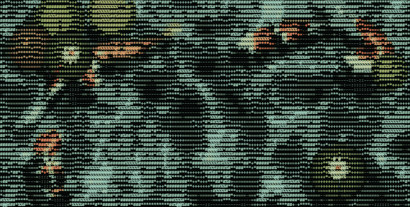

# 鯉の池 · koi pond

Koi swimming in a jade pond, drawn live in coloured ASCII. Each frame is painted as a
picture (pebbles, light lines on the floor, lily pads, shadows, koi), then every
character cell takes its colour from that picture and its glyph from the ramp
` .:-=+*#%@`.

**[Open the pond →](https://muhkartal.github.io/koi-pond/)**

## Play

| | |
| --- | --- |
| Move | stir the water; ripples bend the view beneath them |
| Fast swipe | startles nearby koi |
| Hold still | curious koi come and nibble |
| Click | drop food |
| Drag a lily pad | move it |
| Space | scatter sakura petals |
| C | colour or plain characters |

One HTML file, no build step and no dependencies. Inspired by
[git-koi](https://github.com/yalongwastaken/git-koi).
